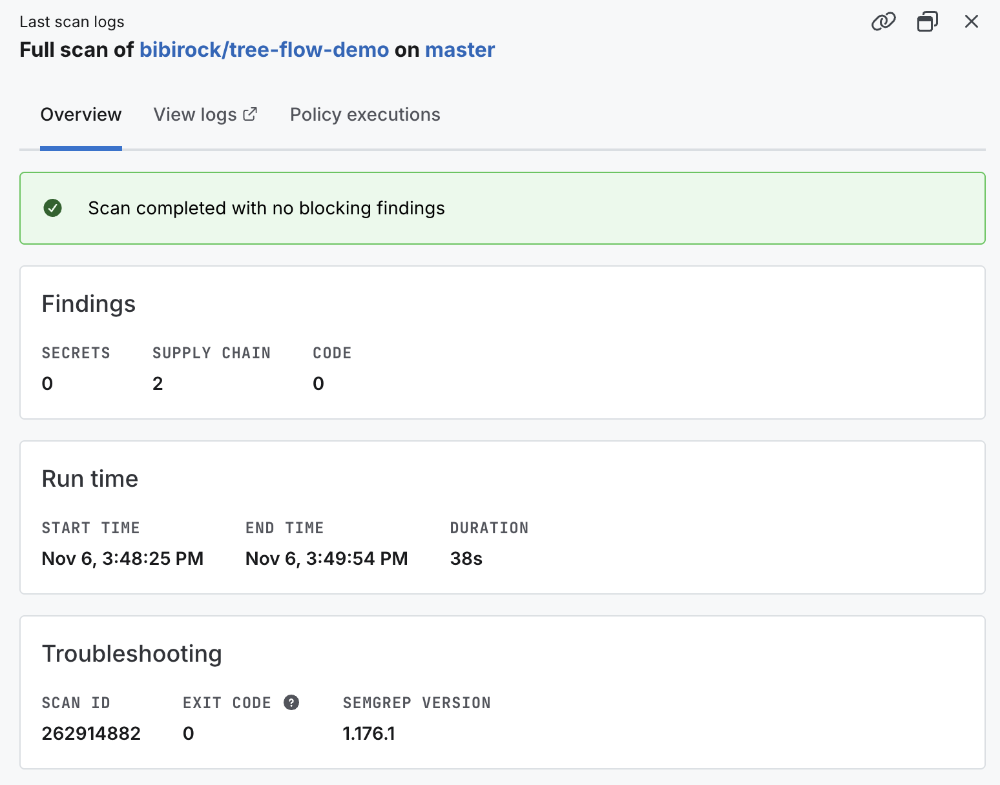

# Flow Lab

我透過重寫渲染器來改善整體渲染速度，並比較 React Flow 與自繪 Canvas 的表現。開發過程使用已建立的 E2E 與單元測試約束 AI 產出，確認替換渲染器後仍符合預期功能。展示使用相同的合成資料與佈局，預設載入一萬個節點。

[線上展示](https://bibirock.github.io/tree-flow-demo/)

## 啟動

需求：Node.js 22.12+、npm 10+。

```bash
npm ci
npm run dev
```

本機網址：http://127.0.0.1:5174/

正式版本可使用：

```bash
npm run build
npm run preview
```

## 功能與量測

- 支援樹狀／網狀視圖、來源切換、深度限制、節點高亮、路徑聚焦及縮放。
- 切換 Canvas 與 React Flow，或按「依序比較兩版」，查看相同資料下的呈現時間。
- 點選節點與聚焦路徑會保留當下視窗；需要重新調整比例時，按「適應畫面」。

量測結果會受資料量、裝置與執行環境影響，建議在相同設定下比較。

## 錯誤回退

切換至「錯誤回退測試」頁面，點擊上方的錯誤重現按鈕，確認發生錯誤後是否自動切換至 React Flow，並可繼續操作圖形。

## 檢查與測試

```bash
npm run lint
npm test
npm run build
npx playwright install chromium
npm run test:e2e
```

## CI/CD

流程定義於 `.github/workflows/pages.yml`，在推送至 `master`、對 `master` 的 PR 或手動觸發時執行。預設權限為唯讀 `contents: read`，同一分支的重複執行會取消較舊者；所有第三方 Actions 與 Semgrep 映像皆釘選至固定 commit／digest，避免可變標籤帶來的供應鏈風險。

### 流程概覽

| 階段       | 內容                                                                                   |
| ---------- | -------------------------------------------------------------------------------------- |
| `semgrep`  | 以 `semgrep ci` 掃描機密、依賴供應鏈與程式碼；有阻擋等級的發現時流程失敗               |
| `validate` | `npm ci`、格式檢查、ESLint、單元測試、Playwright 無頭 E2E、正式建置及 Pages 子路徑驗證 |
| `deploy`   | 僅在 `master` 推送且 `semgrep` 與 `validate` 都通過後，才部署至 GitHub Pages           |

- `semgrep` 與 `validate` 並行執行，PR 只做檢查，不會上傳或部署。
- Pages 建置使用 `--base=/<repo 名稱>/`，並以 `playwright.pages.config.ts` 對建置結果再跑一次測試，確認子路徑下資源與路由可用。
- E2E 失敗時會保留 `playwright-report/` 與 `test-results/` 為 artifact（7 天）。
- `.semgrepignore` 排除 `node_modules/`、`dist/` 與測試報告等非原始碼輸入。

### 安全性掃描結果

下圖為 `master` 分支的 Semgrep 完整掃描（Nov 6，耗時 38 秒，Semgrep 1.176.1，exit code 0）：



| 類別         | 發現數 |
| ------------ | ------ |
| Secrets      | 0      |
| Supply Chain | 2      |
| Code         | 0      |

掃描狀態為「Scan completed with no blocking findings」：沒有機密外洩與程式碼問題。
